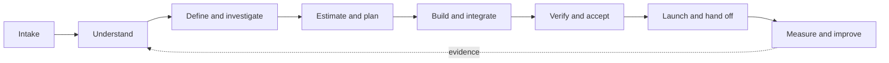

<p align="center"></p>

<p align="center">
<a href="README.zh-CN.md">简体中文</a> · <a href="docs/en/quickstart.md">Quick start</a> · <a href="docs/en/validation.md">What is verified</a> · <a href="skills/project-delivery/SKILL.md">Agent skill</a>
</p>

<p align="center">
<a href="LICENSE"></a>


<a href="https://github.com/simonstone-dev/delivery-os/actions/workflows/ci.yml"></a>
</p>

# Stop rebuilding your project-discovery process.

**DeliveryOS turns scattered client material into a project you can understand, estimate and deliver—with evidence behind the plan.**

Bring your requirements, meeting notes, spreadsheets, screenshots and existing system information. Work with your coding agent to connect:

**Sources → business understanding → requirements → feasibility → work packages → acceptance → handoff.**

Built for consultants, solution architects, founders and delivery teams—including project owners who need to discuss technology without being low-level engineers.

## Try it in one minute

Requires Python 3.10+. No package installation, API key or network access for the CLI.

```bash
git clone https://github.com/simonstone-dev/delivery-os.git
cd delivery-os
python delivery.py demo --dest demo-en --lang en
python delivery.py check demo-en --strict --verify-files
python delivery.py estimate demo-en
python delivery.py report demo-en
```

You get a portable project folder with three synthetic source files, linked requirements, six work packages, open questions, bilingual-capable agent guidance and a generated `PROJECT_REPORT.md`.

The authored demo totals **7.5 / 13 / 23 person-days** across optimistic / likely / pessimistic scenarios. Cost stays **null** because no rates were supplied. Business acceptance stays **pending**. These are deliberate teaching examples, not client estimates or proof of autonomous AI performance.

For Chinese output, use `--lang zh` and another destination, such as `demo-zh`.

## What changes in your workflow

| Without a maintained process | With DeliveryOS |
|---|---|
| Re-explain the project in every chat | Portable project state and versioned agent instructions |
| Mix client requests, AI guesses and meeting summaries | Explicit claim types, source locations and shared origins |
| Write a polished proposal before checking feasibility | Investigate high-impact unknowns and preserve test limits |
| Guess effort from headcount or an AI discount | Work-package estimates with evidence; capacity as a cross-check |
| Treat a successful demo as delivery acceptance | Separate implementation, technical, business and go-live states |
| Update scope but forget the estimate or tests | Trace links and a snapshot generated from canonical records |

## Start your own project

```bash
python delivery.py init --name "Client discovery" --dest projects/client-discovery --lang en
```

Put original files in the new project's `inbox/`, open that project with your coding agent, and use this prompt:

> Read AGENTS.md and use the bundled project-delivery skill. Inventory the material and report actual reading coverage. Explain the business, current process, problems, final deliverables and implementation in plain language. Separate documented requirements, proposals, conflicts and untested assumptions. Investigate what you can; turn client-only gaps into a concise request. Build the feasibility, work estimate, acceptance and handoff plan incrementally. Keep project state and linked records consistent.

The initializer includes a self-contained skill and both language references. You can move the generated project to another location and run its bundled script without the original repository. No global skill installation is required; the agent must have file access and be instructed to read the guidance.

## Who does what

| Component | Responsibility |
|---|---|
| **Your agent** | Read files using available tools, explain the business, investigate options, propose architecture and maintain records |
| **Offline CLI** | Initialize projects, inventory/deduplicate files, check trace links and source hashes, aggregate effort, render reports |
| **Responsible people** | Confirm business rules, provide private access, make commercial decisions, approve acceptance and production use |

The CLI does not perform OCR, understand arbitrary documents, call models or implement the customer's business system. Agent quality depends on its model, tools, inputs and review. DeliveryOS makes that work structured and inspectable.

## One lifecycle, adaptable depth



Use a bounded initial proposal when the customer needs an early answer. Deepen evidence before making stronger commitments. Read the full [workflow](skills/project-delivery/references/en/workflow.md), [estimation method](skills/project-delivery/references/en/estimation.md) and [owner-explanation guide](skills/project-delivery/references/en/teaching-and-review.md).

## Commands and checks

| Command | Result |
|---|---|
| `init --name NAME --dest PATH --lang en` | New project; existing paths are never overwritten |
| `demo --dest PATH --lang en` | Complete authored synthetic example |
| `index PROJECT` | SHA-256 inventory; duplicates retain aliases; same-path changes are rejected |
| `check PROJECT --strict --verify-files` | Record errors, warnings and current primary-file hashes |
| `check PROJECT --gate handover` | Also rejects recorded pending acceptance, blocking questions or unapproved production state |
| `estimate PROJECT` | Three effort scenarios; complete labor cost only when all required rates exist |
| `report PROJECT` | Fresh Markdown snapshot; add `--include-cost` to include labor cost |

Exit codes: **0** success, **1** invalid input or failed checks, **2** warnings under `--strict`. JSON diagnostics contain English and Chinese messages. Record checks cannot authenticate an approval or certify a production system.

## Verification you can reproduce

```bash
python -m unittest discover -s tests -v
python scripts/verify_release.py
```

Tests exercise both languages, fresh initialization, portable execution, source versions, deduplication, bad inputs, traceability, cycles, missing rates, report consistency and rejected premature handoff. Release checks cover local links, language-pair coverage, versions and public-file hygiene. CI runs the same checks on Windows, Ubuntu and macOS with Python 3.10 and 3.12.

See [validation scope and scenario rubric](docs/en/validation.md). Synthetic examples validate mechanics and illustrate judgment; they do not establish project success rates, estimation accuracy or universal AI savings.

## Reuse and contribute

- English and Chinese templates share the same filenames, schema and command contract.
- Each generated project carries its method version; upgrades are reviewed rather than silently applied.
- Client inboxes and local working directories are ignored by Git. Keep customer material out of the public method repository.
- Inspired by published delivery and estimating guidance; see [references and tool choices](docs/en/references.md).
- Share a reproducible improvement through an issue or pull request. Start with [CONTRIBUTING.md](CONTRIBUTING.md).

**Version 0.2.0 · MIT · Practical workflows, visible assumptions, reusable evidence.**
