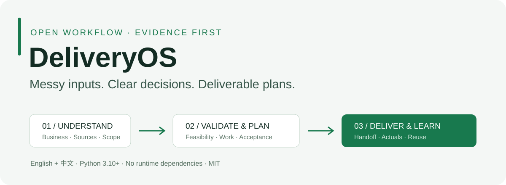
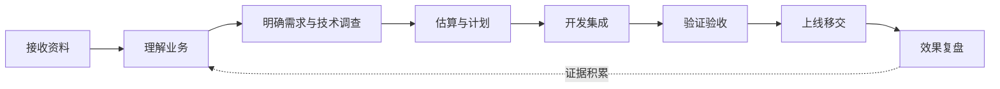

<p align="center"></p>

<p align="center"><a href="README.md">English</a> · <a href="docs/zh/quickstart.md">快速上手</a> · <a href="docs/zh/validation.md">验证范围</a> · <a href="skills/project-delivery/SKILL.md">AI技能</a></p>

# 让每个新项目，都站在上一个项目的经验上。

**DeliveryOS 帮你把零散客户资料，变成看得懂、估得清、交得出的项目计划，并保留每个重要判断的依据。**

把需求、会议纪要、表格、聊天截图和系统资料交给你的编程助手，沿着同一条链路推进：

**资料 → 业务理解 → 需求 → 可行性 → 工作包 → 验收 → 移交。**

适合项目承接人、顾问、解决方案架构师、创业团队和交付团队，也适合需要与专业技术人员沟通的非技术负责人。

## 一分钟体验

需要 Python 3.10+。命令行工具无需安装第三方包、配置 API Key 或联网。

```bash
git clone https://github.com/simonstone-dev/delivery-os.git
cd delivery-os
python delivery.py demo --dest demo-zh --lang zh
python delivery.py check demo-zh --strict --verify-files
python delivery.py estimate demo-zh
python delivery.py report demo-zh
```

你会得到一个可独立移动的项目目录：三份合成资料、关联需求、六个工作包、待确认问题、支持双语的AI指引，以及生成的 `PROJECT_REPORT.md`。

演示人天为乐观／基准／保守 **7.5／13／23**。未提供单价，因此金额保持 **null**；业务验收保持 **pending**。这是人工编写的教学案例，不是客户报价，也不证明AI已自主分析成功。

英文项目使用 `--lang en`，并选择不同目录，例如 `demo-en`。

## 它改变哪些工作

| 常见问题 | DeliveryOS 的处理 |
|---|---|
| 换聊天又从头解释 | 项目状态、方法版本和技能随项目携带 |
| 甲方要求、AI猜测、会议摘要混在一起 | 记录结论性质、来源位置和同源关系 |
| 方案写完才发现技术依赖不成立 | 主动调查影响决策的未知，保留验证边界 |
| 用人数和月份倒推人天，或统一套AI折扣 | 按工作包与依据估算，再检查人员容量 |
| 演示跑通就当成验收 | 实现、技术、业务、上线分别记录 |
| 需求更新了，人天和测试没跟上 | 关联台账与依据它生成的最新快照 |

## 开始自己的项目

```bash
python delivery.py init --name "客户项目" --dest projects/client-discovery --lang zh
```

把原始资料放进新项目的 `inbox/`，用编程助手打开该项目，输入：

> 读取 AGENTS.md，使用随项目携带的 project-delivery 技能。先登记资料并报告实际阅读覆盖，再用通俗语言带我理解业务、现状、问题、最终交付和实现方式。区分资料要求、建议、冲突与未验证假设。你能调查的先调查，只有客户能提供的整理成简短清单。逐步完成可行性、人天、验收和移交计划，保持项目状态与台账一致。

新项目带有完整技能和中英参考，可以独立移动并运行，不依赖原仓库，也无需全局安装技能。助手需要有文件访问能力，并按提示读取项目指引。

## AI、工具和人分别做什么

| 部分 | 职责 |
|---|---|
| **你的AI助手** | 用现有工具读资料、解释业务、调查路线、设计方案并维护记录 |
| **本地命令行** | 初始化、文件索引与去重、引用及哈希检查、人天汇总和报告生成 |
| **有职责的人** | 确认规则、提供私有访问、决定商务条件、验收和批准上线 |

命令行本身不做OCR、不自动理解任意文件、不调用模型，也不直接实现客户业务系统。AI效果依赖所用模型、工具、输入和复核；这套方法让过程有结构、有依据、可检查。

## 从零到交付，按风险决定深度



客户需要早期答复时，可先交有明确假设的初案；承诺加深时，证据也应随之加深。详见[完整流程](skills/project-delivery/references/zh/workflow.md)、[估算方法](skills/project-delivery/references/zh/estimation.md)和[讲解与评审](skills/project-delivery/references/zh/teaching-and-review.md)。

## 命令与检查

| 命令 | 结果 |
|---|---|
| `init --name 名称 --dest 路径 --lang zh` | 建立新项目；不覆盖已有目录 |
| `demo --dest 路径 --lang zh` | 生成完整合成案例 |
| `index 项目路径` | SHA-256索引，重复文件保留别名，同路径内容变更拒绝更新 |
| `check 项目路径 --strict --verify-files` | 检查台账、引用和主来源文件哈希 |
| `check 项目路径 --gate handover` | 额外拒绝尚未验收、未解决阻断项和未批准的上线状态 |
| `estimate 项目路径` | 汇总三种人天情景；单价齐全时才给完整人力成本 |
| `report 项目路径` | 生成最新Markdown快照；加 `--include-cost` 才显示成本 |

退出码：**0** 成功，**1** 输入或检查错误，**2** 严格模式发现提醒。JSON诊断同时含中英文。结构检查不能认证签字真实性，也不能证明生产系统达标。

## 自己复现验证

```bash
python -m unittest discover -s tests -v
python scripts/verify_release.py
```

测试覆盖两种语言、新建项目、独立移动执行、来源版本、去重、错误输入、追溯、依赖环、单价缺失、报告一致性和过早移交拦截。发布检查覆盖链接、翻译配对、版本和公开文件卫生。CI在 Windows、Ubuntu、macOS 的 Python 3.10及3.12上执行相同检查。

详见[验证范围与场景标准](docs/zh/validation.md)。合成案例验证工具机制并示范判断方法；不能据此宣称真实项目成功率、估算准确率或统一AI提效比例。

## 复用与贡献

- 两种语言共用文件名、数据结构和命令约定。
- 每个项目固定方法版本，升级时逐项评估。
- 客户资料和工作目录默认忽略提交，通用公开仓库不接收客户原件。
- 参考来源和现成工具取舍见[参考说明](docs/zh/references.md)。
- 欢迎提交可复现的改进，先读[贡献指南](CONTRIBUTING.md)。

**0.2.0版 · MIT许可 · 判断有依据，计划可检查，经验能复用。**
